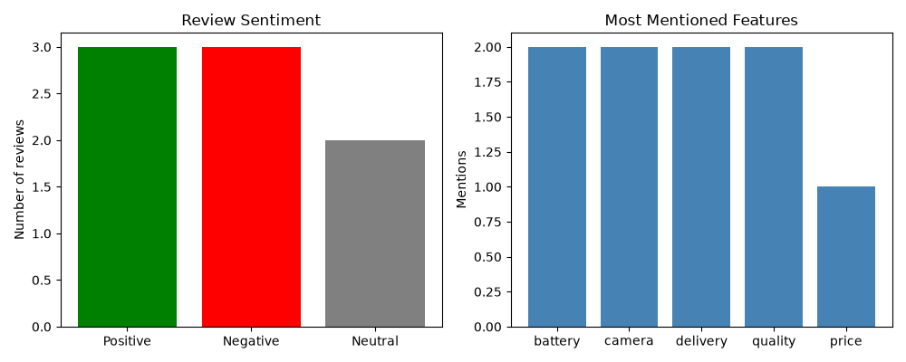

# Review Analyzer

A beginner-friendly Python project that analyzes product reviews and labels each one as Positive, Negative or Neutral.

## How to run
1. Install Python
2. Download `analyzer.py`
3. Run: `python analyzer.py`

## Sample output
Positive: Great battery life and amazing camera. Love it!
Negative: Terrible delivery, the phone arrived broken.

## Planned upgrades
- Detect keywords (battery, camera, price)
- Find common complaints
- Read reviews from a CSV file
- Add a simple dashboard
