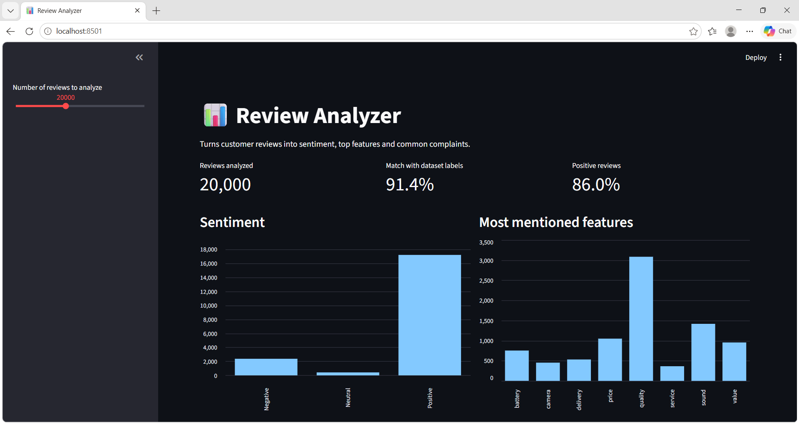

# Review Analyzer

**🔴 Live demo:** [Open the app](https://review-analyzer-nikhil.streamlit.app/)

A Python project that analyzes product reviews and labels each one as Positive, Negative or Neutral. It also finds the most mentioned product features and the most common complaints.

## Results
- Analyzed 20,000 real Flipkart product reviews
- First version (simple word lists): 45.8% match with the dataset's labels
- Improved version (VADER sentiment tool on review summary + text): **91.4%** match
- Note: about 82% of the reviews in the dataset are positive, and the program is weakest at detecting Neutral reviews

## Dataset
[Flipkart Product reviews with sentiment Dataset](https://www.kaggle.com/datasets/niraliivaghani/flipkart-product-customer-reviews-dataset) by Nirali Vaghani on Kaggle. Download `Dataset-SA.csv`, rename it to `big_reviews.csv` and put it in the same folder as `analyzer.py`. (It is not included here because the file is large.)
The live demo uses a random sample of 30,000 reviews.

## How to run
1. Install Python
2. Install the requirements: `python -m pip install -r requirements.txt`
3. Add `big_reviews.csv` (see Dataset above)
4. Run the web dashboard: `python -m streamlit run app.py`
   (or the simple script version: `python analyzer.py`)

   
## Planned upgrades
- Better detection of Neutral reviews
- Show complaints per product
